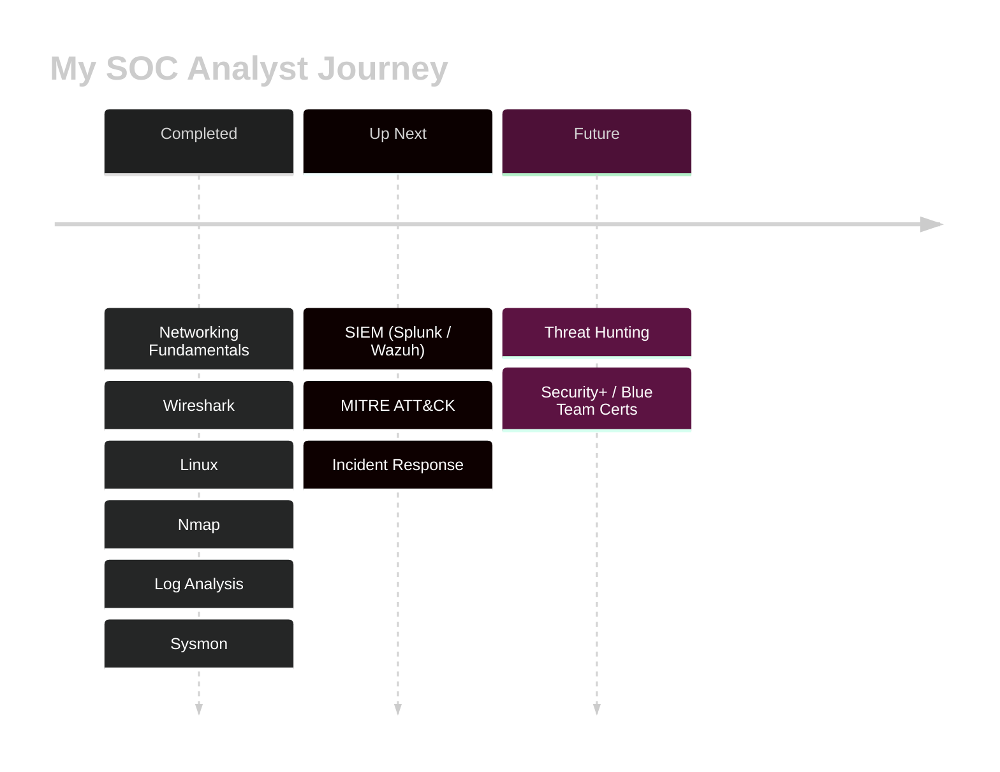

<!-- ===================== HEADER ===================== -->
<!-- ===================== HEADER ===================== -->

 

---

## 🛡️ About Me

I'm a cybersecurity student on a path to becoming a **SOC (Security Operations Center) Analyst**. I enjoy digging into logs, spotting suspicious behavior, and understanding *how* attacks look from the defender's side. I'm building my skills step by step through hands-on practice and lab work.

🎯 **Goal:** Start my career as a Tier 1 SOC Analyst and grow into threat detection & incident response.

---

## 🧰 Skills & Tools

 

 

| Area | What I've Learned |
|------|-------------------|
| 🌐 **Networking** | Fundamentals, TCP/IP, common protocols |
| 🔍 **Packet Analysis** | Wireshark |
| 🐧 **Linux** | Command line, file system, permissions, log files |
| 📡 **Scanning** | Nmap (host discovery, port & service scanning) |
| 📜 **Log Analysis** | Reading and filtering system & authentication logs |
| 🪟 **Windows / Endpoint** | Sysmon telemetry |
| 🎮 **Hands-on Practice** | TryHackMe labs |

---

## 🗺️ Learning Roadmap

| Progress | |
|---|---|
| Fundamentals |  |
| Detection & Analysis |  |
| SIEM & Incident Response |  |

---

## 📊 GitHub Stats

 

 

---

<i>“Every log tells a story. I'm learning to read them.”</i> 🔐

