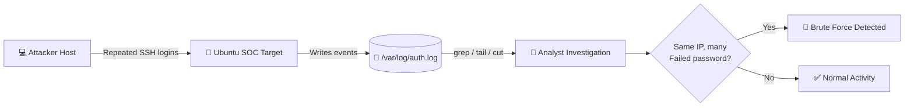
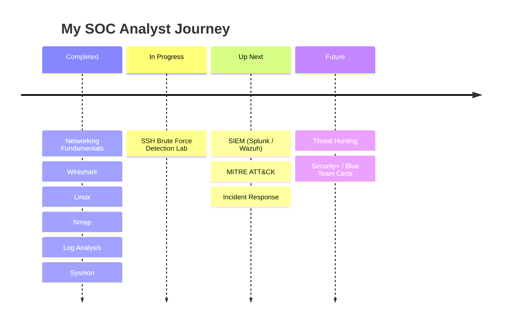

<!-- ===================== HEADER ===================== -->
<div align="center">


<a href="https://git.io/typing-svg">
  
</a>

<br/>


</div>

---

## 🛡️ About Me

I'm a cybersecurity student on a path to becoming a **SOC (Security Operations Center) Analyst**. I enjoy digging into logs, spotting suspicious behavior, and understanding *how* attacks look from the defender's side. I build hands-on lab projects to turn theory into real detection skills.

🎯 **Goal:** Start my career as a Tier 1 SOC Analyst and grow into threat detection & incident response.

---

## 🧰 Skills & Tools

<div align="center">


<br/><br/>


</div>

| Area | What I've Learned |
|------|-------------------|
| 🌐 **Networking** | Fundamentals, TCP/IP, common protocols |
| 🔍 **Packet Analysis** | Wireshark |
| 🐧 **Linux** | Command line, file system, permissions, log files |
| 📡 **Scanning** | Nmap (host discovery, port & service scanning) |
| 📜 **Log Analysis** | Linux `auth.log`, filtering & investigation |
| 🪟 **Endpoint Monitoring** | Sysmon telemetry |

---

## 🚀 Featured Project: SSH Brute Force Detection

**Goal:** Detect brute-force login attempts against an SSH service by analyzing Linux authentication logs in a home SOC lab.

### 🗺️ Detection Workflow



### 🧪 Lab Setup
- **Target:** Ubuntu machine (`ubuntu-soc-target`) running OpenSSH
- **Source:** Separate host on the lab network attempting repeated SSH logins
- **Data Source:** `/var/log/auth.log`

### 💻 Investigation in Action

```console
soc@ubuntu-soc-target:~$ sudo grep "Failed password" /var/log/auth.log | tail -n 10
sshd[2402]: Failed password for soc from 192.168.163.1 port 50926 ssh2
sshd[2402]: Failed password for soc from 192.168.163.1 port 50926 ssh2
sshd[2402]: Failed password for soc from 192.168.163.1 port 50926 ssh2

soc@ubuntu-soc-target:~$ sudo grep -c "Failed password" /var/log/auth.log
```

> 📸 *Add your screenshot here:* ``

### 📌 Key Findings
- Repeated `Failed password` events for the same user from a single source IP in a short time window = **classic brute-force indicator**.
- Useful fields: **timestamp, username, source IP, source port, service (sshd)**.
- My own `sudo` commands also appeared in the log, a reminder that **analyst actions are logged too**.

### 📚 What I Learned
- How SSH authentication failures appear in `auth.log`
- Filtering noisy logs to find real signals
- Normal failed logins vs. brute-force patterns

### 🔜 Next Steps

| Task | Status |
|------|--------|
| Automate detection with a Bash/Python script | 🔲 Planned |
| Block offenders with Fail2Ban | 🔲 Planned |
| Forward logs to a SIEM (Splunk / Wazuh / ELK) | 🔲 Planned |
| Map to MITRE ATT&CK (T1110 – Brute Force) | 🔲 Planned |
| Write a full incident report | 🔲 Planned |

---

## 🗺️ Learning Roadmap



<div align="center">

| Progress | |
|---|---|
| Fundamentals |  |
| Detection & Analysis |  |
| SIEM & IR |  |

</div>

---

## 📊 GitHub Stats

<div align="center">


<br/>


<br/>


</div>

---

## 📫 Let's Connect

<div align="center">

<a href="https://www.linkedin.com/in/your-profile"></a>
<a href="mailto:your.email@example.com"></a>

<br/><br/>

<i>“Every log tells a story. I'm learning to read them.”</i> 🔐


</div>
